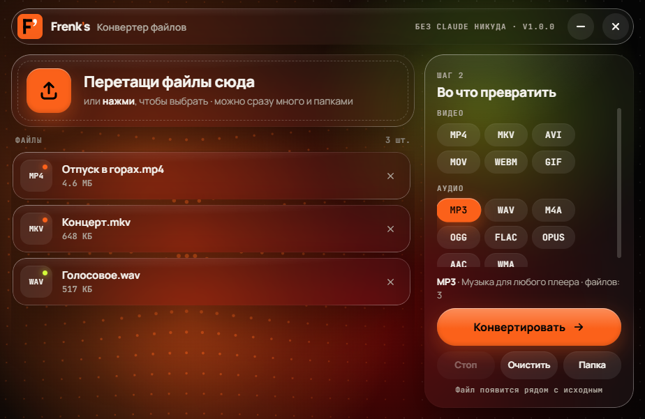
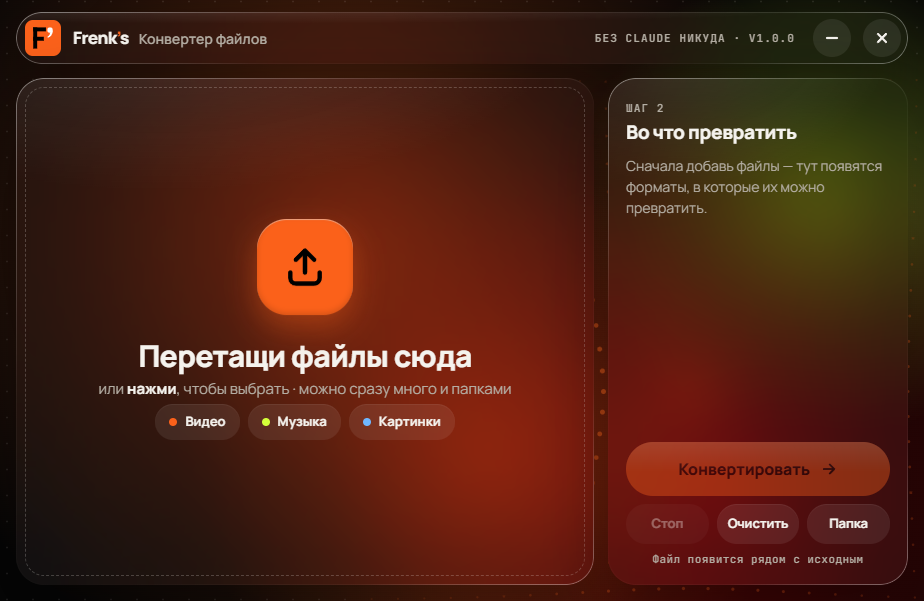
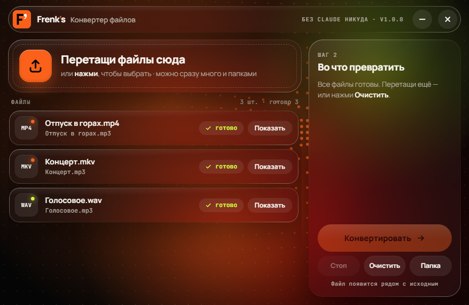

<div align="center">


# Frenk's Converter

**Конвертер видео, музыки и картинок для Windows.**<br>
Перетащи файл, выбери формат — готово. Без регистрации, рекламы и интернета.

[](https://github.com/Frenk1997/frenks-converter/releases/latest)
&nbsp;

&nbsp;
[](LICENSE)



</div>

## Что умеет

- **Видео → звук.** Достать музыку из клипа: MP4 → MP3 одним кликом.
- **Видео → видео и GIF.** MKV, AVI, MOV, WEBM → MP4 и обратно, нарезка в анимированный GIF.
- **Музыка.** MP3, WAV, M4A, FLAC, OGG, OPUS и другие — в любую сторону.
- **Картинки.** HEIC с iPhone → JPG, PNG → WEBP, картинка → иконка `.ico` или PDF.
- **Много файлов сразу.** Можно перетаскивать целые папки, они встанут в очередь.
- **Меню правой кнопки.** Щёлкни по файлу → «Конвертировать в…» → MP3. Окно можно даже не открывать.
- **Оригинал не трогается.** Новый файл появляется рядом. Если такое имя уже занято, будет `имя (1).mp3`.
- **Работает офлайн.** Файлы никуда не загружаются, всё делается на твоём компьютере.

## Скачать и установить

Открой **[последний релиз](https://github.com/Frenk1997/frenks-converter/releases/latest)** и выбери файл:

| Файл | Для кого |
|---|---|
| `FrenksConverter-1.0.0-setup.exe` | **Обычная установка.** Ярлык на рабочем столе и пункт в меню правой кнопки. Права администратора не нужны. |
| `FrenksConverter-1.0.0-portable.zip` | **Без установки.** Распакуй куда угодно и запусти `FrenksConverter.exe`. Меню правой кнопки в этом варианте нет. |

> **Windows может предупредить «Система Windows защитила ваш компьютер».** Так бывает с любой
> программой без платной цифровой подписи. Нажми **«Подробнее» → «Выполнить в любом случае»**.
> Исходный код открыт, а exe можно собрать самому — см. [«Сборка из исходников»](#сборка-из-исходников).

Программе нужен Microsoft Edge WebView2. В Windows 10 и 11 он уже есть.

## Как пользоваться

<table>
<tr>
<td width="50%"></td>
<td width="50%"></td>
</tr>
<tr>
<td align="center">1. Перетащи файлы в окно</td>
<td align="center">2. Выбери формат и нажми «Конвертировать»</td>
</tr>
</table>

**Три способа:**

1. **Окно.** Открой Frenk's Converter, перетащи файлы (или нажми и выбери), выбери формат → **Конвертировать**.
2. **Правая кнопка мыши.** По файлу → **Показать дополнительные параметры** → **Конвертировать в…** → нужный формат.
   Совет: **Shift + правая кнопка** сразу открывает полное меню.
3. **Ярлык.** Перетащи файлы прямо на значок программы на рабочем столе.

Двойной щелчок по готовому файлу в списке откроет папку, где он лежит.

## Форматы

| Что на входе | Во что можно превратить |
|---|---|
| **Видео:** mp4, mkv, avi, mov, webm, wmv, flv, m4v, 3gp, mpg, ts, mts… | mp4, mkv, avi, mov, webm, gif + любой аудиоформат |
| **Аудио:** mp3, wav, m4a, aac, ogg, flac, opus, wma, aiff, amr, ac3 | mp3, wav, m4a, ogg, flac, opus, aac, wma |
| **Картинки:** jpg, png, webp, heic, avif, bmp, tiff, ico | jpg, png, webp, bmp, ico, tiff, pdf |
| **GIF** | mp4, webm, mkv, png, jpg… |

<details>
<summary>Настройки качества по умолчанию</summary>

| Формат | Как кодируется |
|---|---|
| MP3 | LAME VBR `-q:a 2` (~190 кбит/с) |
| M4A / AAC | AAC 192 кбит/с |
| OGG | Vorbis `-q:a 6` |
| OPUS | 160 кбит/с |
| MP4 / MOV / MKV | H.264 CRF 20, звук AAC 192 кбит/с |
| WEBM | VP9 CRF 32 + Opus |
| GIF | 12 кадров/с, до 480 px по ширине, своя палитра |
| JPG | качество 95; прозрачность заменяется белым фоном |

</details>

## Частые вопросы

**Куда сохраняется файл?**
В ту же папку, где лежит исходный. Оригинал не меняется и не удаляется.

**Можно ли сконвертировать сразу и видео, и картинки?**
Да. Программа покажет все подходящие форматы и подпишет, сколько файлов в выбранный формат подходит
(например, «подойдёт 2 из 3»). Остальные подождут в списке.

**Нужен ли интернет?**
Нет. FFmpeg уже внутри программы, всё работает офлайн.

**Как удалить?**
«Параметры» → «Приложения» → Frenk's Converter → «Удалить». Пункты меню правой кнопки и ярлыки удалятся вместе с программой.

**Что-то не работает.**
Журнал ошибок лежит в `%LOCALAPPDATA%\FrenksConverter\error.log`. Приложи его к
[issue](https://github.com/Frenk1997/frenks-converter/issues).

## Сборка из исходников

Понадобятся Python 3.12, [FFmpeg](https://www.gyan.dev/ffmpeg/builds/) и [Inno Setup 6](https://jrsoftware.org/isinfo.php):

```powershell
winget install Python.Python.3.12 Gyan.FFmpeg JRSoftware.InnoSetup
```

```powershell
git clone https://github.com/Frenk1997/frenks-converter.git
cd frenks-converter
python -m venv .venv
.venv\Scripts\pip install -r requirements.txt pyinstaller
```

Запустить без сборки:

```powershell
.venv\Scripts\python src\frenks_converter.py
```

Собрать exe, портативный zip и установщик (всё появится в `dist\`):

```powershell
.venv\Scripts\python tools\build.py
```

Скрипт берёт `ffmpeg.exe` из `PATH` или из папки в переменной `FFMPEG_DIR`.

### Как устроено

```
src/
  frenks_converter.py   окно (pywebview + WebView2), очередь, одно окно на все запуски
  engine.py             конвертация: FFmpeg для видео и звука, Pillow для картинок
  ui/index.html         интерфейс: liquid glass, живой фон, перетаскивание
installer/
  FrenksConverter.iss   установщик Inno Setup (ярлыки, меню правой кнопки)
tools/build.py          сборка: PyInstaller → ffmpeg → zip → установщик
assets/                 иконка, логотип, скриншоты
```

## Лицензия

Код — [MIT](LICENSE). Готовые сборки включают FFmpeg (GPL v3) и другие компоненты,
их лицензии перечислены в [THIRD_PARTY_NOTICES.md](THIRD_PARTY_NOTICES.md).

---

<details>
<summary>🇬🇧 English</summary>

**Frenk's Converter** is a free, offline video, audio and image converter for Windows 10/11.
Drop files into the window or right-click a file → *Convert to…* → pick a format.
The new file appears next to the original; the original is never changed.

- 41 input formats, 21 output formats (MP4, MP3, GIF, WEBM, FLAC, JPG, PNG, WEBP, ICO, PDF…)
- iPhone HEIC photos → JPG/PNG
- batch conversion, whole folders, one shared queue
- per-user installer, no admin rights; portable zip also available
- FFmpeg bundled, no internet required

Download: **[latest release](https://github.com/Frenk1997/frenks-converter/releases/latest)**.
The exe is not code-signed, so Windows SmartScreen may warn you: click *More info → Run anyway*.

Build: `python tools/build.py` (needs Python 3.12, FFmpeg, Inno Setup 6). License: MIT; bundled FFmpeg is GPL v3.

</details>

<div align="center">
<sub>Сделано <a href="https://github.com/Frenk1997">Frenk's</a> · Без Claude никуда</sub>
</div>
